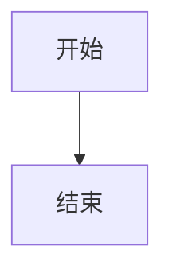

# 文档维护

本站是独立的 VitePress 项目（`AzurPilotDoc`），不放在三个源码仓库里。它只读取源码事实，不修改源码。

## <DocIcon name="folder" /> 目录

```text
AzurPilotDoc/
├── docs/
│   ├── .vitepress/
│   │   ├── config.mts          # 导航、侧边栏、SEO、搜索
│   │   ├── data/               # 从源码生成的 JSON
│   │   └── theme/              # 主题、组件、样式
│   ├── public/                 # 静态资源
│   ├── guide/                  # 开始使用
│   ├── azurpilot/              # 核心程序（user / developer）
│   ├── android/                # Android（user / developer）
│   ├── launcher/               # 启动器（user / developer）
│   ├── api/                    # 接口
│   ├── reference/              # 查表
│   ├── troubleshooting/        # 排障
│   └── contributing/           # 贡献
├── docs-audit/                 # 审计与验收记录
├── scripts/                    # 生成与检查脚本
├── tests/                      # Playwright 验收
├── DESIGN.md                   # 设计规范
└── AGENTS.md                   # 文档站工作约定
```

## <DocIcon name="circle-plus" /> 新增一页

<Steps>
<Step title="建文件">

在对应目录下建 `.md`，文件名即 URL（`cleanUrls` 已开启，无 `.html`）。

</Step>
<Step title="写元数据">

```yaml
---
title: 页面标题
description: 40–160 字，说明这页解决什么问题，会进入 meta description。
updated: 2026-10-20
---
```

`title` 与 `description` 都会进入 SEO 与结构化数据，不能空着。描述短于 40 字会被检查脚本提示——太短在搜索结果里没有信息量。

</Step>
<Step title="挂侧边栏">

在 `docs/.vitepress/config.mts` 的 `sidebar` 对应前缀下加 `{ text, link }`。没挂的页面不会被导航到。

</Step>
<Step title="加交叉引用">

正文至少链接到两个相关页面，避免孤岛。链接用根路径（`/azurpilot/user/device`）或相对 `.md`。

</Step>
<Step title="跑检查">

```bash
npm run check
npm run build
```

</Step>
</Steps>

## <DocIcon name="box" /> 组件

| 组件 | 用途 |
| --- | --- |
| `<Figure caption="">` | 图片/图示容器，带等宽说明 |
| `<Steps>` + `<Step title="">` | 编号步骤 |
| `<Reveal :delay="">` | 进入视口时淡入（尊重 reduced motion） |
| `<CoreArchDiagram />` | 核心程序分层（色带） |
| `<AndroidStack />` | Android 分层（色带） |
| `<TaskTable />` | 102 个任务的可筛选表 |
| `<ApiTable />` | 72 个方法的可展开表 |

组件都是 SSR 友好的：首屏 HTML 包含完整内容，JS 只负责交互。

## <DocIcon name="zap" /> 流程图

流程、时序、关系图直接用 Mermaid 写，不要做成 Vue 组件——改一行 Markdown 比改 SVG 坐标快得多：

````md

````

约定：

- 每个节点标签最多三行，每行都短到不会自动换行。Mermaid 先量尺寸再渲染，标签自动换行时会算出偏小的盒子，最后一行会被裁掉。
- 节点标签里可以用 `<br/>` 换行。
- 颜色由 `config.mts` 的 `mermaid` 段统一控制，不在页面里写 `%%{init}%%`。

**分层架构图不走 Mermaid**：那种「左侧层名 + 通栏色带」的版式用 SVG 组件更可控，见 `CoreArchDiagram.vue`。


## <DocIcon name="drive" /> 生成数据

不要手抄任务名、参数或接口。

```bash
python scripts/extract-tasks.py  ../_audit_src/AzurPilot <commit>
python scripts/extract-api.py    ../_audit_src/AzurPilot <commit>
python scripts/extract-config.py ../_audit_src/AzurPilot <commit>
python scripts/gen-task-reference.py  ../_audit_src/AzurPilot
python scripts/gen-config-reference.py
```

输出在 `docs/.vitepress/data/`，随站点一起构建。源码更新后重跑并检查 diff。

## <DocIcon name="wrench" /> 检查脚本

| 脚本 | 检查 |
| --- | --- |
| `check-links.mjs` | 内部链接、锚点、图片路径 |
| `check-coverage.mjs` | 侧边栏与页面一致、孤立页面、必填 frontmatter |
| `check-seo.mjs` | title/description 唯一、canonical、H1、JSON-LD，全部读构建产物 |
| `capture.mjs` | 46 张全页截图，外加 16 页 × 7 个断点的溢出与标题遮挡扫描 |

`npm run check` 依次运行前三个，`npm run shots` 单独跑截图体检（会自行拉起预览服务）。CI 与本地命令一致。

`check-seo.mjs` 读的是 `docs/.vitepress/dist`，不是开发服务器。改完 `transformHead` 一类的逻辑，必须重新 `npm run build` 才能验到效果。

## <DocIcon name="pencil" /> 写作规范

### 说人话

- 先结论，后解释。
- 一句只做一件事，长句拆开。
- 删除「众所周知」「不难发现」「本文将介绍」这类零信息句。
- 保留准确术语：`NextRun`、`PRoot`、`Job Object` 不要意译成模糊说法。

### 事实标注

| 情况 | 写法 |
| --- | --- |
| 源码确认 | 直接陈述，附文件路径 |
| 只在某平台成立 | 明确平台与条件 |
| 未实测 | 写「未验证」或放进待核实清单 |

### 不要做

- 不要为凑页面把功能拆成十篇空文。
- 不要用宣传语代替操作步骤。
- 不要编造配置项、命令、接口。
- 不要照抄来路不明的旧命令，一切以当前源码为准。
- 不要用截图冒充当前版本（截图必须注明来源与版本）。

## <DocIcon name="monitor" /> 截图

| 要求 | 说明 |
| --- | --- |
| 来源 | 优先真实软件截图；仓库 `docs/screenshots/` 可直接引用 |
| 标注 | 图注写明界面与版本 |
| 尺寸 | 宽度 ≥ 1200，避免放大失真 |
| 隐私 | 遮蔽账号、UID、服务器名、密码 |
| alt | 描述图中内容，不是文件名 |

禁止生成假的软件界面。架构图用 SVG 组件，不用 AI 生成图。

## <DocIcon name="rocket" /> 发布

```bash
npm run build          # 输出 docs/.vitepress/dist
```

纯静态目录，可部署到 Cloudflare Pages、GitHub Pages、Nginx 或任意 CDN。CI 工作流见 `.github/workflows/docs.yml`。

::: warning 不要直接覆盖线上站点
部署前确认目标域名与项目。默认构建产物只用于预览与产物检查。
:::
