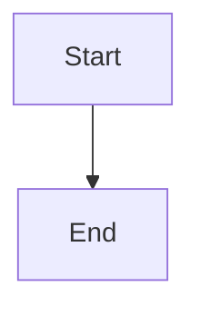

# Documentation Maintenance

This site is an independent VitePress project (`AzurPilotDoc`), maintained separately from the three codebase repositories. It extracts facts from source code without modifying upstream production code.

## <DocIcon name="folder" /> Directory Architecture

```text
AzurPilotDoc/
├── docs/
│   ├── .vitepress/
│   │   ├── config.mts          # Navigation, sidebars, SEO, search
│   │   ├── data/               # JSON datasets generated from source
│   │   └── theme/              # Theme styling, components, overrides
│   ├── public/                 # Static images and icons
│   ├── guide/                  # Getting Started guides
│   ├── azurpilot/              # Core program manuals (user / developer)
│   ├── android/                # Android host manuals (user / developer)
│   ├── launcher/               # Desktop launcher manuals (user / developer)
│   ├── api/                    # API specifications
│   ├── reference/              # Command and configuration references
│   ├── troubleshooting/        # Troubleshooting methodologies
│   └── contributing/           # Contribution guidelines
├── docs-audit/                 # Audit inventories and verification reports
├── scripts/                    # Generation and validation scripts
├── tests/                      # Playwright E2E browser tests
├── DESIGN.md                   # Site design specifications
└── AGENTS.md                   # Agent conventions
```

## <DocIcon name="circle-plus" /> Adding a Documentation Page

<Steps>
<Step title="Create markdown file">

Create a `.md` file under the target directory. The filename forms the URL (`cleanUrls` is enabled, omitting `.html`).

</Step>
<Step title="Author frontmatter metadata">

```yaml
---
title: Page Title
description: 40–160 characters describing the problem this guide solves; populates meta descriptions.
updated: 2026-10-20
---
```

`title` and `description` populate search indexes and structured data. Descriptions shorter than 40 characters trigger linter warnings.

</Step>
<Step title="Attach to sidebar">

Add the `{ text, link }` entry under the corresponding prefix in `docs/.vitepress/config.mts`. Unlisted pages trigger coverage errors.

</Step>
<Step title="Add cross-references">

Link to at least two related internal pages to prevent orphan content. Use root-relative paths (`/en/azurpilot/user/device`).

</Step>
<Step title="Execute validation checks">

```bash
npm run check
npm run build
```

</Step>
</Steps>

## <DocIcon name="box" /> Reusable Custom Components

| Component | Function |
| --- | --- |
| `<Figure caption="">` | Image / diagram container with monospace caption |
| `<Steps>` + `<Step title="">` | Numbered step container |
| `<Reveal :delay="">` | Viewport fade-in container (respects reduced motion) |
| `<CoreArchDiagram />` | Core program architectural layer diagram |
| `<AndroidStack />` | Android host stack diagram |
| `<TaskTable />` | Interactive searchable table of all 102 tasks |
| `<ApiTable />` | Interactive expandable table of all 72 API methods |

All components are SSR-safe: initial HTML contains full content; JavaScript handles progressive enhancement.

## <DocIcon name="zap" /> Diagrams

Author workflows and state machines using Mermaid directly in Markdown rather than creating custom Vue components:



Rules:

- Node labels must not exceed three lines, keeping text short to prevent unwanted line wrapping.
- Use `<br/>` for intentional line breaks inside node labels.
- Theme styling is governed centrally by `config.mts`; do not write local `%%{init}%%` blocks.

## <DocIcon name="drive" /> Generated Datasets

Never transcribe task names, configuration parameters, or API methods by hand.

```bash
python scripts/extract-tasks.py  ../_audit_src/AzurPilot <commit>
python scripts/extract-api.py    ../_audit_src/AzurPilot <commit>
python scripts/extract-config.py ../_audit_src/AzurPilot <commit>
python scripts/gen-task-reference.py  ../_audit_src/AzurPilot
python scripts/gen-config-reference.py
```

Outputs compile to `docs/.vitepress/data/`. Re-run scripts and review git diffs following upstream updates.

## <DocIcon name="wrench" /> Validation Test Scripts

| Script | Validation Scope |
| --- | --- |
| `check-links.mjs` | Internal links, anchor slugs, public assets |
| `check-coverage.mjs` | Sidebar parity, orphan pages, required frontmatter |
| `check-seo.mjs` | Unique titles/descriptions, canonical tags, H1 counts, JSON-LD schemas |
| `capture.mjs` | Full-page screenshots across 7 responsive breakpoints |

`npm run check` executes link, coverage, and SEO checks. `check-seo.mjs` evaluates `docs/.vitepress/dist`, requiring a build step first.

## <DocIcon name="pencil" /> Technical Writing Style

- State conclusions before explanations.
- One thought per sentence; decompose complex compounds.
- Delete empty filler phrases ("as everyone knows", "it is easy to see").
- Preserve exact technical terminology: do not loosely paraphrase identifiers like `NextRun`, `PRoot`, or `Job Object`.

## <DocIcon name="monitor" /> Screenshot Standards

- Prioritize real application screenshots; reference assets in `docs/screenshots/` directly.
- Captions must identify interface view and software release version.
- Image widths must be ≥ 1200 pixels to prevent pixelation.
- Redact account numbers, UIDs, server names, and credentials.
- Image alt text must describe visual content rather than repeating filenames.
