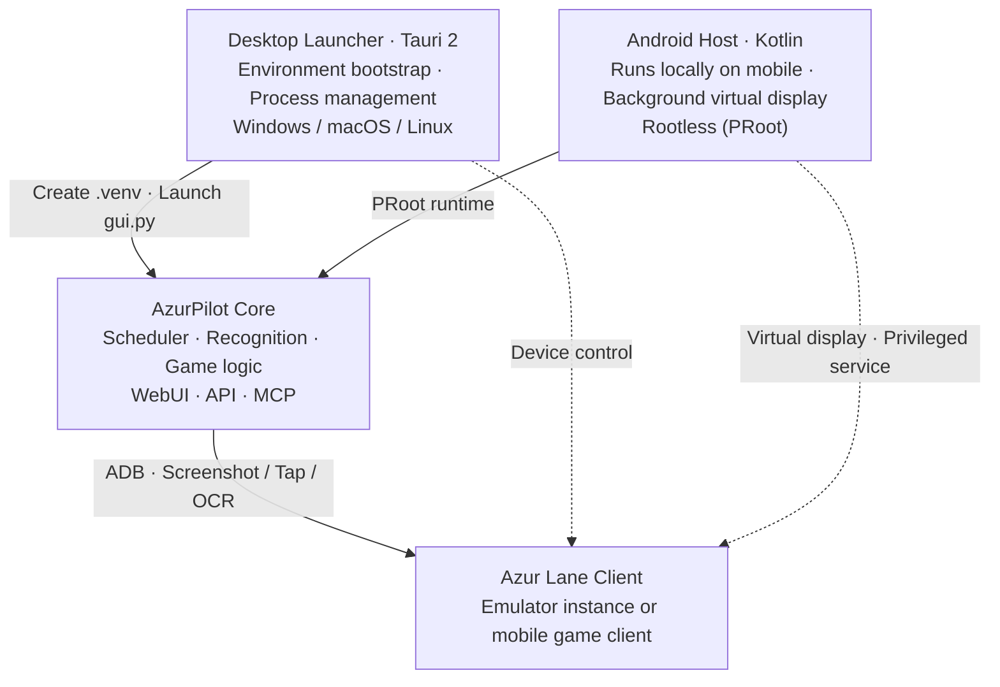

# The Three Projects

The three repositories are often mistaken for "three versions", but they actually form **one core engine plus two hosts**. Choosing the wrong repository can lead you to mistake the launcher for the automation script itself or assume the Android app has an independent logic implementation.



<small>Solid lines indicate startup and code distribution; dashed lines indicate device control pipelines. The core program does not care which host spawns it.</small>

## <DocIcon name="scale" /> Responsibility Matrix

<table>
<thead>
<tr><th>Repository</th><th>Default Branch</th><th>Language / Framework</th><th>License</th><th>Responsible For</th><th>Not Responsible For</th></tr>
</thead>
<tbody>
<tr>
<td><a href="https://github.com/wess09/AzurPilot">wess09/AzurPilot</a></td>
<td><code>master</code></td>
<td>Python 3.14 · React · Vite</td>
<td>GPL-3.0</td>
<td>Scheduling, recognition, game logic, WebUI, API, MCP</td>
<td>Provisioning Python environments, process management, mobile porting</td>
</tr>
<tr>
<td><a href="https://github.com/wess09/AzurPilotLauncher">wess09/AzurPilotLauncher</a></td>
<td><code>main</code></td>
<td>Rust · Tauri 2</td>
<td>GPL-3.0</td>
<td>Desktop environment bootstrapping, code updates, backend process lifecycle, system tray, notifications</td>
<td>Any in-game behavior</td>
</tr>
<tr>
<td><a href="https://github.com/wess09/AzurPilot-for-Android">wess09/AzurPilot-for-Android</a></td>
<td><code>main</code></td>
<td>Kotlin · Compose · C++ · Python Runtime</td>
<td>AGPL-3.0</td>
<td>PRoot runtime, virtual display, privileged services, OCR hardware acceleration, remote client</td>
<td>Game logic (reuses upstream core)</td>
</tr>
</tbody>
</table>

::: tip Default Branch Discrepancy
The core repository uses `master`, while the other two repositories use `main`. Links copied from older articles frequently hit 404s due to this difference.
:::

## <DocIcon name="handshake" /> Dependency Flow

```text
Launcher ──git pull──▶ AzurPilot (core repo)
   │                      ▲
   └──uv sync──▶ .venv     │
                           │ Same source code bundled into rootfs
Android ──PRoot──▶ Ubuntu 24.04 ──▶ AzurPilot
```

- <DocIcon name="refresh" /> **The launcher does not bundle core code**. It runs `git clone` on initial boot, followed by `git pull` and `uv sync` on subsequent starts. The launcher version and core version operate on completely independent version lines.
- <DocIcon name="package" /> **The Android host embeds core code**. The Runtime image contains a full copy of the AzurPilot source and pre-built frontend assets, allowing offline startup. Upstream updates arrive through an independent hot update channel.
- <DocIcon name="plug" /> **All three share identical WebSocket contracts**. The Android host's `AzurPilotGateway` and the browser WebUI subscribe to the same `/api/v1/ws` endpoint.

## <DocIcon name="package" /> Which One Should You Download

| Your Situation | Choice | Entry Point |
| --- | --- | --- |
| Windows / macOS / Linux PC with emulator | Launcher | [Install Launcher](/en/launcher/user/install) |
| No PC available, or dedicating an old phone to automation | Android APK | [Install Android Version](/en/android/user/install) |
| Already running instances on another PC, monitoring via phone | Android APK in remote client mode | [Remote Client](/en/android/user/remote-client) |
| Modifying code, authoring tasks, integrating APIs | Source repository | [Source Installation](/en/guide/install#source-installation) |
| Server / NAS / Raspberry Pi | Docker or source | [Docker Deployment](#docker-deployment) |

## <DocIcon name="refresh" /> Release Cycles and Versioning

The three repositories release independently; version numbers do not correlate:

- <DocIcon name="refresh" /> **Core**: Rolling updates on `master` without strict semantic versioning. The WebUI "Update" page displays commit lists to review and apply.
- <DocIcon name="medal" /> **Launcher**: Versioned releases (archives) that auto-update via mTLS channels with multi-mirror fallback.
- <DocIcon name="package" /> **Android**: Dual-track releases—lightweight APK (host code) + Runtime (rootfs image), both distributed per ABI.

To learn what happens when updating individual components, read [Update, Backup & Migration](/en/guide/update-backup).

## <DocIcon name="box" /> Docker Deployment

The core repository includes a Dockerfile and `docker-compose.yml`, ideal for headless environments:

```bash
git clone https://github.com/wess09/AzurPilot.git
cd AzurPilot
docker compose up -d --build
```

The image uses a multi-stage build ("Frontend Build → Python Runtime"). The container launches via `.venv/bin/python gui.py`. The repository also provides `deploy/docker/Dockerfile.cn` configured for mainland China network mirrors.

::: warning No Emulator Inside Container
The container only hosts the WebUI and scheduler. The emulator runs on the host OS. You must forward ADB ports into the container or configure `network_mode: host`.
:::

## <DocIcon name="file" /> Licensing

These licenses are copyleft: distributed modified versions must comply with GPL-3.0 / AGPL-3.0. Because the Android host delivers services over a network, AGPL mandates making corresponding source code available to network users.
