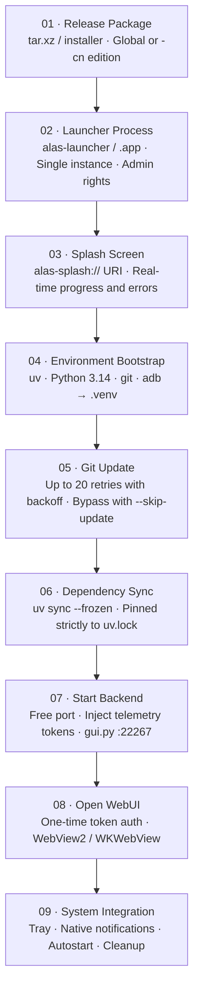

# First Launch & Environment Setup

On first execution, the launcher constructs a complete, isolated Python runtime environment within its directory rather than simply loading a web page.



<small>Initial execution runs all phases; subsequent launches execute phases 05 through 09. Process chain: Launcher (Parent) → `gui.py` (Child) → Instance Workers (Grandchildren), recycled on exit via Windows Job Objects or Unix process groups.</small>

## <DocIcon name="sparkles" /> Splash Screen Architecture

The launcher uses custom URI schemes to serve embedded interfaces:

| Scheme | Purpose |
| --- | --- |
| `alas-splash://` | Displays initialization phases and download progress |
| `alas-error://` | Displays crash details and copyable diagnostic logs |

Progress indicators transition across distinct states: Create `.venv` → Download Python → Update repository → Sync dependencies → Launch backend → Load WebUI.

## <DocIcon name="box" /> Environment Bootstrapping Components

| Component | Source | Target Location |
| --- | --- | --- |
| uv | Embedded at compile time (`ALAS_BOOTSTRAP_UV`) | `.venv` or fallback to system PATH |
| Python 3.14.6 | python-build-standalone binary distribution | `.venv` |
| git | Windows MinGit / compiled binaries | `.venv/bin/git`, `.venv/Scripts/git/cmd/git.exe` |
| adb | Android SDK platform-tools | `.venv/bin/adb`, `.venv/Scripts/adb.exe` |

Python download mirrors are tried sequentially:

```text
npmmirror (preferred default)
mirror.nju.edu.cn
python-standalone.org
github.com/astral-sh/python-build-standalone
```

PyPI packages use regional mirrors (Aliyun, Tencent Cloud, CERNET) before falling back upstream. The `-cn` deployment profile prioritizes regional mirrors automatically.

::: tip Relocatable Virtual Environments
Python locates `pyvenv.cfg` and `site-packages` using relative directories. The entire installation folder can be moved to another path without breaking internal symlinks.
:::

## <DocIcon name="refresh" /> Core Repository Synchronization

```text
git pull → Failed attempt → Exponential backoff retry (up to 20 times) → Success
```

The `deploy.<platform>.yaml` file controls repository targets, branches, proxy settings, and SSL certificate verification:

| Option | Description |
| --- | --- |
| `Git.Repository` | Remote Git repository URL |
| `Git.Branch` | Target branch (defaults to `master`) |
| `Git.GitProxy` | HTTP / SOCKS5 proxy configuration |
| `Git.SSLVerify` | Toggle SSL certificate verification |

::: warning Do Not Change Git Remotes Manually
The launcher enforces repository settings specified in `deploy.yaml`. Manually pointing Git remotes to personal forks risks overwrite or merge conflicts on subsequent launches. Configure forks inside `deploy.yaml` instead.
:::

## <DocIcon name="package" /> Dependency Synchronization

```bash
uv sync --frozen
```

- `--frozen` ensures dependencies are installed strictly matching `uv.lock` without recalculating dependency trees.
- If dependency sync fails, execution halts at the error screen rather than starting an unstable backend.
- Initial synchronization takes the longest; subsequent runs resolve quickly via local package caches.

## <DocIcon name="rocket" /> Backend Process Launch

The launcher spawns `gui.py` as a child process and injects environment variables:

| Variable | Description |
| --- | --- |
| `ALAS_LAUNCHER_PID` | Identifies process ownership for exit cleanup |
| `ALAS_LAUNCHER_JOB_BREAKAWAY` | Signals capability allowing emulator processes to break away from Job Objects |
| `ALAS_WEBUI_TRUST_SECRET` | Single-use authentication token for automatic sign-in |

Execution details:

- Before starting, the launcher frees conflicting processes on the target port (default `22267`). **This terminates any conflicting process using that port**.
- The launcher polls for backend readiness up to 60 seconds before reporting a timeout error.
- The WebUI embeds via WebView; if the Server-Sent Events (SSE) stream drops, it reconnects every 3 seconds.
- The window loads pre-authenticated using an ephemeral session token.

## <DocIcon name="settings" /> Single Instance & System Tray

- Launching a second executable instance shifts focus to the existing window.
- Closing the window minimizes the application to the system tray while workers continue running.
- The tray context menu provides actions to open logs, restart the backend, or terminate the application completely.

## <DocIcon name="circle-alert" /> Initialization Failures

If setup fails, inspect the error screen for stage diagnostics:

| Stage | Common Root Cause | Remediation |
| --- | --- | --- |
| Create `.venv` | Read-only directory or path contains illegal characters | Relocate installation to a clean directory |
| Download Python | Network disconnection or unreachable mirror | Switch network or edit mirror URL in `deploy.yaml` |
| Update repository | Invalid proxy settings, missing branch, or full disk | Inspect `deploy.yaml`; test launch using `--skip-update` |
| Sync dependencies | Unreachable PyPI mirror or mismatch with `uv.lock` | Change PyPI mirror; verify code and lockfile versions match |
| Start backend | Port conflict or Python interpreter crash | Inspect `log/*_launcher.txt` and backend output |
| Open WebUI | Missing WebView2 runtime | Install Microsoft Edge WebView2 |

### Locating Diagnostics Logs

```text
log/<date>_launcher.txt    # Launcher tracing logs
log/<date>_<instance>.txt  # Core program execution logs
```

Launcher logs capture every command invocation, process exit code, and execution duration. Include these snippets when submitting bug reports.

## <DocIcon name="ban" /> Bypassing Repository Updates

```bash
./alas-launcher --skip-update
```

Use this flag in the following situations:

- GitHub is temporarily unreachable, but local code is functional.
- A recent update introduced a regression and you need to inspect local state.
- Operating in air-gapped offline environments with a pre-seeded `.venv`.

## <DocIcon name="message-text" /> Language Configuration

```bash
./alas-launcher --lang ja
```

Available options: `zh-CN`, `zh-TW`, `ja`, `en`. When omitted, the launcher defaults to the operating system locale with fallback to `en`. This flag controls the launcher chrome; WebUI language is defined in `deploy.yaml`.
