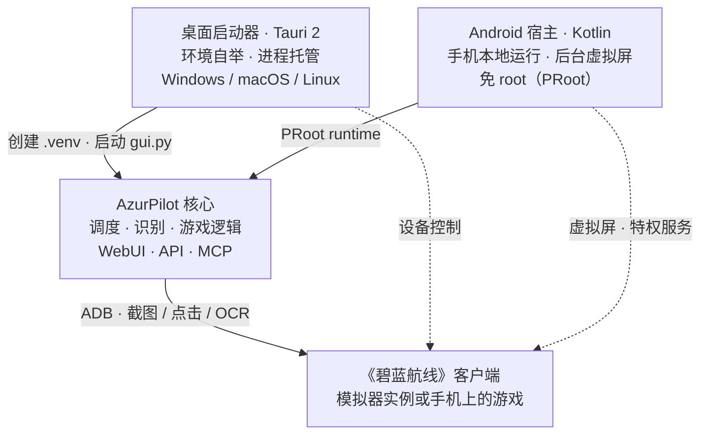

# 三个项目的关系

三个仓库经常被误认为「三个版本」，实际是**一个引擎 + 两个宿主**。选错仓库会导致你把启动器当成脚本本体，或者以为 Android 版有独立的功能实现。



<small>实线：启动与代码分发；虚线：设备控制链路。核心程序不关心自己被谁拉起。</small>

## <DocIcon name="scale" /> 职责对照

<table>
<thead>
<tr><th>仓库</th><th>默认分支</th><th>语言 / 框架</th><th>许可证</th><th>负责</th><th>不负责</th></tr>
</thead>
<tbody>
<tr>
<td><a href="https://github.com/wess09/AzurPilot">wess09/AzurPilot</a></td>
<td><code>master</code></td>
<td>Python 3.14 · React · Vite</td>
<td>GPL-3.0</td>
<td>调度、识别、游戏逻辑、WebUI、API、MCP</td>
<td>准备 Python 环境、托管进程、手机适配</td>
</tr>
<tr>
<td><a href="https://github.com/wess09/AzurPilotLauncher">wess09/AzurPilotLauncher</a></td>
<td><code>main</code></td>
<td>Rust · Tauri 2</td>
<td>GPL-3.0</td>
<td>桌面环境自举、代码更新、后端进程托管、托盘与通知</td>
<td>任何游戏行为</td>
</tr>
<tr>
<td><a href="https://github.com/wess09/AzurPilot-for-Android">wess09/AzurPilot-for-Android</a></td>
<td><code>main</code></td>
<td>Kotlin · Compose · C++ · Python Runtime</td>
<td>AGPL-3.0</td>
<td>PRoot 运行时、虚拟屏、特权服务、OCR 加速、远程客户端</td>
<td>游戏逻辑（复用上游核心）</td>
</tr>
</tbody>
</table>

::: tip 默认分支不是 master
核心仓库用 `master`，另外两个用 `main`。从旧文章复制链接时经常在这里 404。
:::

## <DocIcon name="handshake" /> 依赖方向

```text
Launcher ──git pull──▶ AzurPilot（核心仓库）
   │                      ▲
   └──uv sync──▶ .venv     │
                           │ 同一份源码被打包进 rootfs
Android ──PRoot──▶ Ubuntu 24.04 ──▶ AzurPilot
```

- <DocIcon name="refresh" /> **启动器不包含核心代码**。它在首次启动时 `git clone` 核心仓库，之后每次启动 `git pull` 并 `uv sync`。所以「启动器版本」和「核心版本」是两条独立的版本线。
- <DocIcon name="package" /> **Android 宿主内置核心代码**。Runtime 镜像里已经包含一份 AzurPilot 源码与前端构建产物，因此断网也能启动；上游更新通过单独的脚本热更新通道完成。
- <DocIcon name="plug" /> **三者共享同一套 WebSocket 协议**。Android 的 `AzurPilotGateway` 与浏览器 WebUI 订阅的是同一个 `/api/v1/ws`。

## <DocIcon name="package" /> 我应该下载哪个

| 你的情况 | 选择 | 入口 |
| --- | --- | --- |
| 有 Windows / macOS / Linux 电脑，用模拟器 | Launcher | [安装启动器](/launcher/user/install) |
| 没有电脑，或想让旧手机专职挂机 | Android APK | [安装 Android 版](/android/user/install) |
| 已经在用其他机器上的实例，只想用手机看 | Android APK 的远程客户端模式 | [远程客户端](/android/user/remote-client) |
| 要改代码、写新任务、调 API | 源码 | [源码运行](/guide/install#源码运行) |
| 服务器 / NAS / 树莓派 | Docker 或源码 | [Docker 部署](#docker-部署) |

## <DocIcon name="refresh" /> 版本与更新节奏

三个仓库独立发布，版本号不互相对应：

- <DocIcon name="refresh" /> **核心**：跟随 `master` 滚动更新，没有严格的语义化版本；WebUI 的「更新」页可以查看提交列表并按需应用。
- <DocIcon name="medal" /> **启动器**：带版本号的 Release（压缩包），通过 mTLS 通道自更新，支持多镜像回退。
- <DocIcon name="package" /> **Android**：双轨发布——轻量 APK（宿主代码）+ Runtime（rootfs 镜像）。两者都按 ABI 分发。

升级其中一个组件后会发生什么，见[更新、备份与迁移](/guide/update-backup)。

## <DocIcon name="box" /> Docker 部署

核心仓库自带 Dockerfile 与 `docker-compose.yml`，适合无桌面环境：

```bash
git clone https://github.com/wess09/AzurPilot.git
cd AzurPilot
docker compose up -d --build
```

镜像分「构建前端 → Python 运行时」两个阶段，容器内以 `.venv/bin/python gui.py` 启动。仓库另有 `deploy/docker/Dockerfile.cn` 供国内网络使用。

::: warning 容器内没有模拟器
容器只提供 WebUI 与调度器。模拟器仍在宿主机上运行，需要把 ADB 端口映射进容器，或用 `network_mode: host`。具体做法取决于你的模拟器与网络拓扑。
:::

## <DocIcon name="file" /> 许可证

许可证具有传染性：分发修改版时必须同时遵守 GPL-3.0 / AGPL-3.0。Android 宿主因为通过网络提供服务，AGPL 要求向网络用户提供对应源码。
