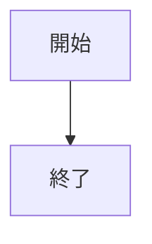

# ドキュメントメンテナンス

本ドキュメントサイトは独立した VitePress プロジェクト（`AzurPilotDoc`）として管理されており、3つのソースコードリポジトリとは分離されています。ソースコードの実態を読み取り記録する場であり、ソースコードのロジック自体を直接改変するものではありません。

## <DocIcon name="folder" /> ディレクトリ構成

```text
AzurPilotDoc/
├── docs/
│   ├── .vitepress/
│   │   ├── config.mts          # ナビゲーション、サイドバー、SEO、検索設定
│   │   ├── data/               # ソースコードから抽出された JSON データ
│   │   └── theme/              # テーマ、カスタムコンポーネント、スタイルシート
│   ├── public/                 # 静的画像リソース
│   ├── guide/                  # 利用ガイド（簡体字中国語）
│   ├── ja/                     # 日本語ドキュメント
│   ├── en/                     # 英語ドキュメント（一部）
│   ├── azurpilot/              # コアプログラム（user / developer）
│   ├── android/                # Android（user / developer）
│   ├── launcher/               # ランチャー（user / developer）
│   ├── api/                    # API リファレンス
│   ├── reference/              # 設定・コマンド対照表
│   ├── troubleshooting/        # トラブルシューティング
│   └── contributing/           # 貢献ガイド
├── docs-audit/                 # 監査および検証記録
├── scripts/                    # データ抽出および静的検査スクリプト
├── tests/                      # Playwright E2E テスト
├── DESIGN.md                   # デザインおよび UI 規約
└── AGENTS.md                   # ドキュメントサイトの運用方針
```

## <DocIcon name="circle-plus" /> 新規ページの追加手順

<Steps>
<Step title="Markdown ファイルの作成">

該当ディレクトリ配下に `.md` ファイルを作成します。ファイル名がそのまま URL パスとなります（`cleanUrls` が有効化されているため `.html` は不要です）。

</Step>
<Step title="フロントマター（メタデータ）の記述">

```yaml
---
title: ページタイトル
description: 40〜160文字でこのページが解決する課題を要約します。meta description に反映されます。
updated: 2026-10-20
---
```

`title` と `description` は SEO および構造化データに使用されるため、省略は禁止されています。記述が短すぎる場合は検索エンジンのスニペットとして機能しないため、検査スクリプトによって警告されます。

</Step>
<Step title="サイドバーへの登録">

`docs/.vitepress/config.mts` の `sidebar`（または各言語のサイドバー設定）の該当グループ内に `{ text, link }` を追加します。登録されていないページはサイト内で孤立します。

</Step>
<Step title="相互リンク（クロスリファレンス）の設置">

孤立ページ化を避けるため、本文中に最低2つ以上の関連ページへのリンクを設けてください。絶対パス（例：`/ja/azurpilot/user/device`）または相対パス（例：`./device.md`）を使用します。

</Step>
<Step title="各種チェックの実行">

```bash
npm run check
npm run build
```

</Step>
</Steps>

## <DocIcon name="box" /> 利用可能なカスタムコンポーネント

| コンポーネント | 用途 |
| --- | --- |
| `<Figure caption="">` | 画像・図示コンテナ。キャプション付き |
| `<Steps>` ＋ `<Step title="">` | 番号付きステップ案内 |
| `<Reveal :delay="">` | スクロールイン時のフェードイン（reduced-motion 配慮） |
| `<CoreArchDiagram />` | コアプログラムのレイヤー階層図（カラーバンド） |
| `<AndroidStack />` | Android のレイヤー階層図（カラーバンド） |
| `<TaskTable />` | 102 個のタスクを絞り込み検索できる対照表 |
| `<ApiTable />` | 72 個のメソッドを展開・検索できる API テーブル |

すべてのコンポーネントは SSR（サーバーサイドレンダリング）に対応しており、初回 HTML に完全な静的コンテンツが含まれ、JS はインタラクティブな機能のエンハンスのみを担当します。

## <DocIcon name="zap" /> フローチャートの記述

処理フロー、シーケンス、依存関係図などは Vue コンポーネント化せず、Mermaid を使用して直接記述してください：



記述上のルール：

- 各ノードのラベルは最大3行にとどめ、各行は自動折り返しが発生しない長さに抑えてください（Mermaid はレンダリング前に寸法を計測するため、自動折り返しが発生するとボックスが小さく算出され末尾が切れる原因となります）。
- ノード内の改行には `<br/>` を明示的に使用してください。
- 配色は `config.mts` の `mermaid` 設定によりサイト全体で統一制御されているため、ページ内に `%%{init}%%` を直接記述しないでください。

**レイヤー階層アーキテクチャ図は Mermaid を使用しません**：「左側にレイヤー名 ＋ 横長カラー帯」の構成は SVG コンポーネント（`CoreArchDiagram.vue` 等）で制御されています。

## <DocIcon name="drive" /> データの自動生成

タスク名、設定項目、API メソッドを手作業で書き写さないでください。

```bash
python scripts/extract-tasks.py  ../_audit_src/AzurPilot <commit>
python scripts/extract-api.py    ../_audit_src/AzurPilot <commit>
python scripts/extract-config.py ../_audit_src/AzurPilot <commit>
python scripts/gen-task-reference.py  ../_audit_src/AzurPilot
python scripts/gen-config-reference.py
```

出力先は `docs/.vitepress/data/` であり、サイトビルド時に読み込まれます。ソースコード更新時はこれらを再実行して差分を確認してください。

## <DocIcon name="wrench" /> 静的検査スクリプト

| スクリプト | 検査内容 |
| --- | --- |
| `check-links.mjs` | 内部リンク、アンカー、画像パスの有効性 |
| `check-coverage.mjs` | サイドバーと全ページの整合性、孤立ページの有無、必須フロントマター |
| `check-seo.mjs` | title/description の一意性、canonical、H1、JSON-LD（ビルド成果物を検証） |
| `capture.mjs` | 46 枚のフルスクリーンショットおよび 16 ページ × 7 ブレークポイントのレイアウト崩れスキャン |

`npm run check` は前3者を順次実行します。`npm run shots` はビジュアルリグレッション検査を単独実行します。

`check-seo.mjs` は開発サーバーではなく `docs/.vitepress/dist` の成果物を検査対象とします。`transformHead` などのメタタグロジックを変更した後は、必ず `npm run build` を実行した上で検証してください。

## <DocIcon name="pencil" /> 執筆規約

### 簡潔かつ明確な技術表現

- 結論を先に述べ、その後に解説を加えてください。
- 一文で伝える要点は一つに絞り、長文は適切に分割してください。
- 「周知のように」「言うまでもなく」「本稿では〜について紹介する」といった無情報な導入句は排除してください。
- 正確な技術用語（`NextRun`、`PRoot`、`Job Object` 等）は曖昧な一般語に意訳せずそのまま使用してください。

### 事実関係の明示

| 状況 | 記述方法 |
| --- | --- |
| ソースコードにより確認済み | 該当するファイルパスを添えて客観的に断定記述 |
| 特定プラットフォームでのみ成立 | 対象プラットフォームと成立条件を明記 |
| 実機未検証 | 「未検証」と明記するか、未解決事項リストに記録 |

### 禁止事項

- ページ数を水増しするために機能を内容の薄い複数ページに分割しないでください。
- 操作手順の説明を曖昧な宣伝文句に置き換えないでください。
- 存在しない設定項目、コマンド、API を推測で記述しないでください。
- 出典不明の古いコマンドを流用せず、現行の最新ソースコードを基準にしてください。
- バージョン不詳の古いスクリーンショットを現行版として掲載しないでください。

## <DocIcon name="monitor" /> スクリーンショットの取り扱い

| 要件 | 規定 |
| --- | --- |
| 出典 | 実際のソフトウェア画面を優先。リポジトリ内の `docs/screenshots/` を直接参照可能 |
| キャプション | 対象画面とバージョンを明記 |
| 解像度 | 拡大時のボケを防ぐため横幅 1200px 以上を推奨 |
| プライバシー | アカウント名、UID、サーバー名、パスワードはマスキング |
| alt 属性 | ファイル名ではなく画面の内容を説明するテキストを指定 |

AI 等による架空の UI 画面の生成は禁止されています。アーキテクチャ図には SVG コンポーネントを使用してください。

## <DocIcon name="rocket" /> デプロイと公開

```bash
npm run build          # docs/.vitepress/dist に静的ファイルを出力
```

純粋な静的ファイル群であるため、Cloudflare Pages、GitHub Pages、Nginx、その他 CDN に配備可能です。CI パイプラインは `.github/workflows/docs.yml` を参照してください。

::: warning 本番環境への不用意な上書き禁止
デプロイ前に配備先のドメインおよび環境設定を確認してください。デフォルトのローカルビルド成果物はプレビューおよび静的検証用です。
:::
