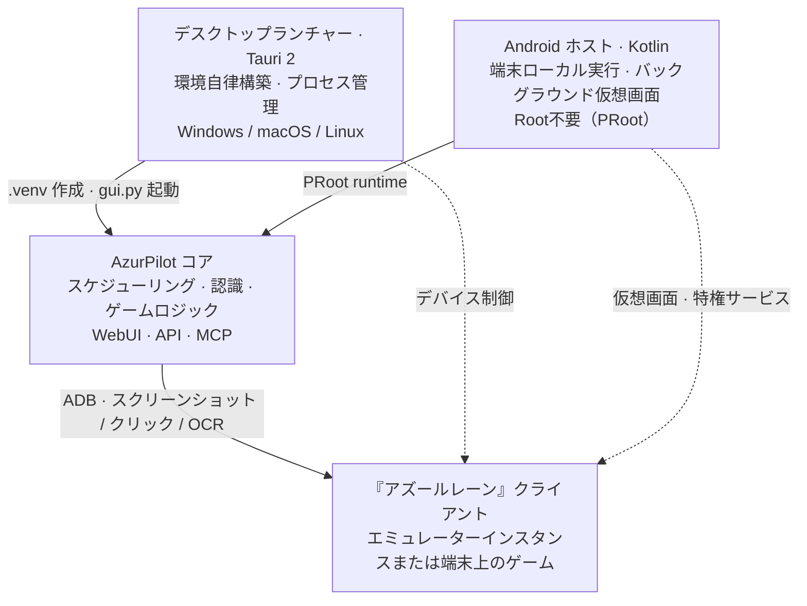

# 3つのプロジェクトの関係

3つのリポジトリは「3つのバージョン」と誤解されがちですが、実際には**1つのエンジン ＋ 2つのホスト**という構成です。リポジトリを誤解すると、ランチャーを自動化スクリプト本体と混同したり、Android 版に独自の機能実装があると誤認する原因になります。



<small>実線：起動とコード配布、破線：デバイス制御パイプライン。コアプログラム自身はどのホストから呼び出されたかを意識しません。</small>

## <DocIcon name="scale" /> 責務の対照表

<table>
<thead>
<tr><th>リポジトリ</th><th>デフォルトブランチ</th><th>言語 / フレームワーク</th><th>ライセンス</th><th>担当領域</th><th>担当外の領域</th></tr>
</thead>
<tbody>
<tr>
<td><a href="https://github.com/wess09/AzurPilot">wess09/AzurPilot</a></td>
<td><code>master</code></td>
<td>Python 3.14 · React · Vite</td>
<td>GPL-3.0</td>
<td>スケジューリング、画像認識、ゲームロジック、WebUI、API、MCP</td>
<td>Python 環境の準備、プロセス管理、スマートフォン向け最適化</td>
</tr>
<tr>
<td><a href="https://github.com/wess09/AzurPilotLauncher">wess09/AzurPilotLauncher</a></td>
<td><code>main</code></td>
<td>Rust · Tauri 2</td>
<td>GPL-3.0</td>
<td>デスクトップ環境の自律構築、コード更新、バックエンドプロセスの管理、トレイと通知</td>
<td>ゲーム内操作の実行</td>
</tr>
<tr>
<td><a href="https://github.com/wess09/AzurPilot-for-Android">wess09/AzurPilot-for-Android</a></td>
<td><code>main</code></td>
<td>Kotlin · Compose · C++ · Python Runtime</td>
<td>AGPL-3.0</td>
<td>PRoot ランタイム、仮想画面、特権サービス、OCR 高速化、リモートクライアント</td>
<td>ゲームロジック（アップストリームのコアを再利用）</td>
</tr>
</tbody>
</table>

::: tip デフォルトブランチの違い
コアリポジトリは `master` を使用し、他の2つは `main` を使用しています。過去の記事などから URL をコピーする際は 404 エラーにご注意ください。
:::

## <DocIcon name="handshake" /> 依存関係の方向

```text
Launcher ──git pull──▶ AzurPilot（コアリポジトリ）
   │                      ▲
   └──uv sync──▶ .venv     │
                           │ 同一ソースコードが rootfs に同梱
Android ──PRoot──▶ Ubuntu 24.04 ──▶ AzurPilot
```

- <DocIcon name="refresh" /> **ランチャーはコアプログラムのコードを含みません**。初回起動時にコアリポジトリを `git clone` し、以後の起動ごとに `git pull` および `uv sync` を行います。そのため、「ランチャーのバージョン」と「コアのバージョン」は独立したリリースサイクルを持ちます。
- <DocIcon name="package" /> **Android ホストはコアプログラムのコードを内包しています**。Runtime イメージ内に AzurPilot のソースコードとフロントエンドのビルド成果物が同梱されているため、オフラインでも起動可能です。アップストリームの更新は専用のスクリプトホットアップデート機構を通じて適用されます。
- <DocIcon name="plug" /> **3者は共通の WebSocket プロトコルを共有します**。Android の `AzurPilotGateway` とブラウザの WebUI は同一の `/api/v1/ws` をサブスクライブします。

## <DocIcon name="package" /> どの配布物をダウンロードすべきか

| ユーザーの利用状況 | 選択肢 | 案内ページ |
| --- | --- | --- |
| Windows / macOS / Linux PC を所持し、エミュレーターを使用する | ランチャー | [ランチャーのインストール](/ja/launcher/user/install) |
| PC がない、または旧スマートフォンを専属で周回させたい | Android APK | [Android 版のインストール](/ja/android/user/install) |
| 他のマシンで稼働中のインスタンスがあり、スマートフォンから閲覧のみ行いたい | Android APK（リモートクライアントモード） | [リモートクライアント](/ja/android/user/remote-client) |
| コード改変、新規タスク作成、API 呼び出しを行いたい | ソースコード | [ソースコード実行](/ja/guide/install#源码运行) |
| サーバー / NAS / Raspberry Pi | Docker またはソースコード | [Docker デプロイ](#docker-デプロイ) |

## <DocIcon name="refresh" /> バージョンとリリースサイクル

3つのリポジトリは個別にリリースされ、バージョン番号は相互に対応していません：

- <DocIcon name="refresh" /> **コア**：`master` ブランチに追従するローリングアップデート形式であり、厳密なセマンティックバージョニングは採用していません。WebUI の「更新」画面からコミット一覧を確認し、手動で適用できます。
- <DocIcon name="medal" /> **ランチャー**：バージョン番号が付与された Release（圧縮アーカイブ）形式で配布され、mTLS 通信による自動更新および複数ミラーへのフォールバックに対応しています。
- <DocIcon name="package" /> **Android**：軽量 APK（ホストコード）と Runtime（rootfs イメージ）の2系統で配布されます。いずれも ABI ごとに提供されます。

コンポーネントを更新した際の動作の詳細は[更新・バックアップ・移行](/ja/guide/update-backup)を参照してください。

## <DocIcon name="box" /> Docker デプロイ {#docker-デプロイ}

コアリポジトリには Dockerfile と `docker-compose.yml` が付属しており、ヘッドレス環境に適しています：

```bash
git clone https://github.com/wess09/AzurPilot.git
cd AzurPilot
docker compose up -d --build
```

イメージは「フロントエンドのビルド → Python ランタイム」の2段階でビルドされ、コンテナ内では `.venv/bin/python gui.py` として起動します。中国本土ネットワーク向けに `deploy/docker/Dockerfile.cn` も用意されています。

::: warning コンテナ内にはエミュレーターが含まれません
コンテナが提供するのは WebUI とスケジューラーのみです。エミュレーターはホストマシン上で動作している必要があるため、ADB ポートをコンテナにマッピングするか、`network_mode: host` を設定してください。設定方法はエミュレーターの仕様とネットワーク構成に依存します。
:::

## <DocIcon name="file" /> ライセンス

ライセンスの伝播性にご注意ください。改変版を配布する際は GPL-3.0 / AGPL-3.0 を遵守する必要があります。特に Android ホストはネットワーク経由でサービスを提供するため、AGPL の規定に基づきネットワーク利用者に対して対応するソースコードを開示する義務が生じます。
