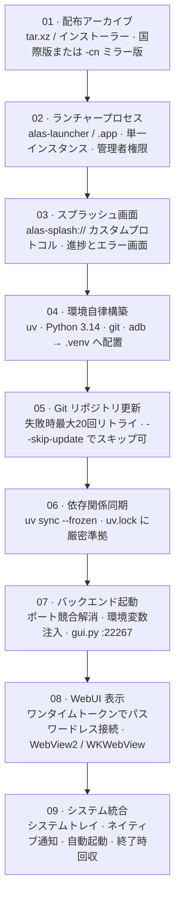

# 初回起動と環境初期化

ランチャーを初めて実行した際に行われる処理は、単に「ブラウザ画面を表示する」ことではありません。ディレクトリ内に独立した完全な Python 実行環境を自動構築します。このパイプラインを把握しておくことで、不具合発生時にどのフォルダを再構築すべきかを的確に判断できます。



<small>初回起動時はすべてのステップ（01〜09）が実行されます。次回以降の起動時は 05〜09 のみが実行されます。プロセス親子関係：ランチャー（親）→ `gui.py`（子）→ インスタンスワーカー（孫）。終了時は Job Object / プロセスグループにより確実に一括終了されます。</small>

## <DocIcon name="sparkles" /> スプラッシュ画面

ランチャーはカスタム URI プロトコルを使用して組み込み UI を描画します：

| プロトコル | 表示内容 |
| --- | --- |
| `alas-splash://` | 初期化プログレス画面（各ステージの進行状況表示） |
| `alas-error://` | エラー表示画面（エラー原因、ログパスのコピー、再試行） |

進行ステージ：`.venv` の作成 → Python の取得 → リポジトリの更新 → 依存関係の同期 → バックエンドの起動 → WebUI の表示。各ステップの進捗はログファイルにも逐次記録されます。

## <DocIcon name="box" /> 環境自律構築の詳細

| コンポーネント | 配布元 | 格納先 |
| --- | --- | --- |
| uv | ビルド時に内包（`ALAS_BOOTSTRAP_UV`） | `.venv` または PATH フォールバック |
| Python 3.14.6 | python-build-standalone | `.venv` |
| git | Windows：MinGit / Unix：システムまたはビルド済み | `.venv/bin/git`、`.venv/Scripts/git/cmd/git.exe` |
| adb | Android platform-tools | `.venv/bin/adb`、`.venv/Scripts/adb.exe` |

Python のダウンロードは以下の優先順位で接続を試みます：

```text
npmmirror（デフォルト最優先）
mirror.nju.edu.cn
python-standalone.org
github.com/astral-sh/python-build-standalone
```

PyPI ミラーも同様に国内高速ミラーが設定されます。`-cn` 版構成では中国国内の CDN が優先されます。

::: tip `.venv` が再配置可能（Relocatable）である理由
Python は `pyvenv.cfg` と `site-packages` を相対パスで検索するため、ディレクトリごと別のドライブやフォルダへ移動しても動作を維持できます。ランチャーがツールチェーン全体を `.venv` 配下に閉じ込めることができるのはこの仕組みによるものです。
:::

## <DocIcon name="refresh" /> コアリポジトリの更新

```text
git pull → 失敗時リトライ（最大20回、指数バックオフ）→ 成功
```

`deploy.<platform>.yaml` がリポジトリのアドレス、ブランチ、プロキシ設定を管理します：

| 設定項目 | 説明 |
| --- | --- |
| `Git.Repository` | リポジトリ URL（CN 版は `git://git.pull/AzurPilot` を指定） |
| `Git.Branch` | デフォルトは `master`（開発者は `dev` 等に変更可能） |
| `Git.GitProxy` | HTTP / SOCKS5 プロキシ設定 |
| `Git.SSLVerify` | SSL 証明書検証の有効/無効 |

::: warning git リポジトリの remote を手動変更してランチャーを使用しないでください
ランチャーは設定ファイル内の URL に基づいて更新を実行します。手作業で Fork 先の remote に差し替えても、次回起動時に公式リポジトリに引き戻されたり競合の原因になります。接続先を変更したい場合は `deploy.yaml` を編集してください。
:::

## <DocIcon name="package" /> 依存関係の同期

```bash
uv sync --frozen
```

- `--frozen` オプションにより、`uv.lock` に記録された固定バージョンのみを厳密にインストールします。
- 依存関係の同期に失敗した場合はエラー画面で待機し、不完全な状態での起動を防止します。
- 初回同期は最も時間を要しますが、2回目以降はキャッシュが効くため数秒で完了します。

## <DocIcon name="rocket" /> バックエンドプロセスの起動

ランチャーは子プロセスとして `gui.py` を起動し、以下の環境変数を注入します：

| 環境変数 | 役割 |
| --- | --- |
| `ALAS_LAUNCHER_PID` | 子プロセスの所属を識別し、異常終了時の安全なクリーンアップを担保 |
| `ALAS_LAUNCHER_JOB_BREAKAWAY` | エミュレータープロセスが Job Object から安全に脱離可能であることを宣言 |
| `ALAS_WEBUI_TRUST_SECRET` | WebUI へのワンタイムパスワードレス認証トークン |

詳細な仕様：

- 起動前に使用ポート（デフォルト `22267`）の競合を解消します。**当該ポートを占有している既存プロセスは終了されます**。
- バックエンドの応答待機時間は最大60秒です。超過時はエラー画面へ遷移します。
- WebUI は WebView を介してレンダリングされ、SSE 通知ストリームが切断された場合は3秒ごとに再接続を試みます。
- ウィンドウ表示時点で認証が完了しているため、パスワードの入力は不要です。

## <DocIcon name="settings" /> 単一インスタンスとトレイ常駐

- 既に起動している状態で再度ランチャーを起動すると、既存のウィンドウにフォーカスが移動し、多重起動を防止します。
- ウィンドウを「×」ボタンで閉じてもプロセスは終了せず、システムトレイに最小化されてバックエンド処理は継続します。
- トレイメニューから「終了」（プロセスの完全停止）、「再起動」、「ログフォルダを開く」を実行できます。

## <DocIcon name="circle-alert" /> 初期化失敗時の対処 {#初始化失败}

エラー画面には発生フェーズとエラー理由が表示されます。フェーズごとの対処手順：

| フェーズ | 主な原因 | 対処方法 |
| --- | --- | --- |
| `.venv` の作成 | フォルダが書き込み禁止 / パスに特殊文字 | ユーザーディレクトリ等へフォルダを移動 |
| Python のダウンロード | ネットワーク遮断、ミラーのダウン | ネットワークを変更するかデプロイ設定のミラーを変更 |
| リポジトリの更新 | プロキシ設定不備、ブランチ名誤り、ディスク容量不足 | `deploy.yaml` の確認、`--skip-update` での起動テスト |
| 依存関係の同期 | PyPI へのアクセス不能、コードと `uv.lock` の不整合 | ミラーの変更。コードと lock ファイルの整合性を確認 |
| バックエンド起動 | ポート競合、Python のクラッシュ | `log/*_launcher.txt` およびバックエンドログを確認 |
| WebUI 表示 | WebView2 ランタイムの欠落 | ランタイムをインストール |

### ログの確認場所

```text
log/<日付>_launcher.txt    # ランチャー本体のログ（tracing 出力）
log/<日付>_<インスタンス>.txt # コアプログラムのログ
```

ランチャーログには各フェーズの実行コマンド、終了コード、処理時間が記録されます。Issue 起票時はこの内容を添付してください。

## <DocIcon name="ban" /> アップデートのスキップ

```bash
./alas-launcher --skip-update
```

利用シナリオ：

- インターネット経由で GitHub にアクセスできないが、ローカルのコードで稼働させたい場合。
- アップデート直後に起動障害が発生し、現在のバージョンのまま調査を行いたい場合。
- 完全にオフラインの環境（すでに構築済みの `.venv` が存在する場合）。

## <DocIcon name="message-text" /> 表示言語の切り替え

```bash
./alas-launcher --lang ja
```

指定可能な値：`zh-CN` / `zh-TW` / `ja` / `en`。未指定時は OS のシステムロケールに従い、該当がない場合は `en` にフォールバックします。このパラメータはランチャー自身の画面にのみ適用され、WebUI の言語は設定ファイルの指定に従います。
