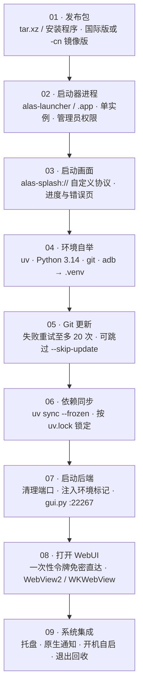

# 首次启动与环境初始化

启动器第一次运行时做的不是「打开一个网页」，而是在你的目录里搭一套完整的 Python 运行环境。理解这条链路，出问题时就知道该删哪个目录。



<small>首次启动会执行全部步骤，之后只跑 05–09。常驻进程链：启动器（父）→ `gui.py`（子）→ 实例 worker（孙），退出时按 Job Object / 进程组回收。</small>

## <DocIcon name="sparkles" /> 启动画面

启动器用自定义 URI 协议加载内嵌页面：

| 协议 | 内容 |
| --- | --- |
| `alas-splash://` | 启动画面与进度 |
| `alas-error://` | 错误页（可复制日志） |

进度按阶段推进：创建 `.venv` → 下载 Python → 更新仓库 → 同步依赖 → 启动后端 → 打开 WebUI。每一步都有对应的日志行。

## <DocIcon name="box" /> 环境自举做了什么

| 组件 | 来源 | 位置 |
| --- | --- | --- |
| uv | 构建时内嵌（`ALAS_BOOTSTRAP_UV`） | `.venv` 或 PATH 回退 |
| Python 3.14.6 | python-build-standalone | `.venv` |
| git | Windows MinGit / Unix 源码编译 | `.venv/bin/git`、`.venv/Scripts/git/cmd/git.exe` |
| adb | Android platform-tools | `.venv/bin/adb`、`.venv/Scripts/adb.exe` |

Python 下载源按顺序尝试：

```text
npmmirror（默认首选）
mirror.nju.edu.cn
python-standalone.org
github.com/astral-sh/python-build-standalone
```

PyPI 镜像同理（阿里云、腾讯云、CERNET）。`-cn` 部署配置会优先国内源。

::: tip 为什么 .venv 是可重定位的
Python 通过相对路径找 `pyvenv.cfg` 与 `site-packages`，整个目录可以随项目移动。这也是启动器能把工具链全部塞进 `.venv` 的前提。
:::

## <DocIcon name="refresh" /> 更新核心仓库

```text
git pull → 失败重试（至多 20 次，指数退避）→ 成功
```

`deploy.<platform>.yaml` 决定仓库地址、分支、代理与 SSL 校验：

| 字段 | 说明 |
| --- | --- |
| `Git.Repository` | 仓库地址；CN 版用 `git://git.pull/AzurPilot` |
| `Git.Branch` | 默认 `master`；开发者可改 `dev` |
| `Git.GitProxy` | HTTP / SOCKS5 代理 |
| `Git.SSLVerify` | 是否校验证书 |

::: warning 不要手动改 git 仓库的 remote 后继续用启动器
启动器按部署配置里的地址更新。手动换成 fork 后，下次启动可能被拉回原仓库，或产生冲突。要换源就改 `deploy.yaml`。
:::

## <DocIcon name="package" /> 依赖同步

```bash
uv sync --frozen
```

- `--frozen` 表示完全按 `uv.lock` 安装，不重新解析。
- 依赖安装失败会停在错误页，不会带病启动。
- 首次同步耗时最长，后续命中缓存会快很多。

## <DocIcon name="rocket" /> 启动后端

启动器以子进程方式运行 `gui.py`，并注入环境标记：

| 变量 | 作用 |
| --- | --- |
| `ALAS_LAUNCHER_PID` | 标记子进程归属，退出时兜底清理 |
| `ALAS_LAUNCHER_JOB_BREAKAWAY` | 能力声明，允许模拟器脱离 Job |
| `ALAS_WEBUI_TRUST_SECRET` | 一次性免密登录令牌 |

细节：

- 启动前清理端口占用（默认 `22267`）。**这会结束占用该端口的进程**，如果你同时跑了别的 AzurPilot 实例，注意冲突。
- 等待后端就绪最多 60 秒；超时进入错误页。
- WebUI 通过 WebView 承载，SSE 通知流断开后每 3 秒重连。
- 窗口打开时已完成登录，不需要输入密码。这不代表 WebUI 没有密码，只是启动器预置了会话。

## <DocIcon name="settings" /> 单实例与托盘

- 重复启动会聚焦已有窗口，不会再起一个后端。
- 关闭窗口默认最小化到托盘，后端继续运行。
- 托盘菜单可以退出（真正结束后端）、重启、打开日志目录。

## <DocIcon name="circle-alert" /> 初始化失败

错误页会显示阶段与原因。按阶段排查：

| 阶段 | 常见原因 | 处理 |
| --- | --- | --- |
| 创建 `.venv` | 目录只读 / 路径含特殊字符 | 换目录 |
| 下载 Python | 网络不通、镜像不可用 | 换网络或改部署配置源 |
| 更新仓库 | 代理错误、分支不存在、磁盘满 | 检查 `deploy.yaml`、`--skip-update` 试启动 |
| 同步依赖 | PyPI 不可达、`uv.lock` 与代码不匹配 | 换镜像；确认代码与锁文件同版本 |
| 启动后端 | 端口被占用、Python 崩溃 | 看 `log/*_launcher.txt` 与后端日志 |
| 打开 WebUI | WebView2 缺失 | 安装运行时 |

### 查看日志

```text
log/<日期>_launcher.txt    # 启动器（tracing）
log/<日期>_<实例>.txt       # 核心程序
```

启动器日志包含每个阶段的命令、退出码与耗时。提 Issue 时附这一段。

## <DocIcon name="ban" /> 跳过更新

```bash
./alas-launcher --skip-update
```

适用场景：

- 网络无法访问 GitHub，但本地代码可用。
- 更新后启动失败，想回到当前版本排查。
- 离线环境（需已有完整 `.venv`）。

## <DocIcon name="message-text" /> 语言

```bash
./alas-launcher --lang ja
```

可选 `zh-CN` / `zh-TW` / `ja` / `en`。不指定时按系统 locale 自动选择，回退 `en`。这个参数只影响启动器界面，WebUI 语言由部署配置决定。
