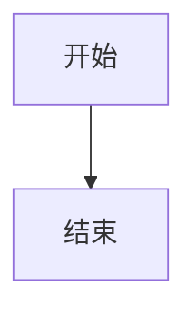

# 文檔維護

本站是獨立的 VitePress 項目（`AzurPilotDoc`），不放在三個源碼倉庫裏。它只讀取源碼事實，不修改源碼。

## <DocIcon name="folder" /> 目錄

```text
AzurPilotDoc/
├── docs/
│   ├── .vitepress/
│   │   ├── config.mts          # 导航、侧边栏、SEO、搜索
│   │   ├── data/               # 从源码生成的 JSON
│   │   └── theme/              # 主题、组件、样式
│   ├── public/                 # 静态资源
│   ├── guide/                  # 开始使用
│   ├── azurpilot/              # 核心程序（user / developer）
│   ├── android/                # Android（user / developer）
│   ├── launcher/               # 启动器（user / developer）
│   ├── api/                    # 接口
│   ├── reference/              # 查表
│   ├── troubleshooting/        # 排障
│   └── contributing/           # 贡献
├── docs-audit/                 # 审计与验收记录
├── scripts/                    # 生成与检查脚本
├── tests/                      # Playwright 验收
├── DESIGN.md                   # 设计规范
└── AGENTS.md                   # 文档站工作约定
```

## <DocIcon name="circle-plus" /> 新增一頁

<Steps>
<Step title="建檔案">

在對應目錄下建 `.md`，檔案名即 URL（`cleanUrls` 已開啟，無 `.html`）。

</Step>
<Step title="寫元數據">

```yaml
---
title: 页面标题
description: 40–160 字，说明这页解决什么问题，会进入 meta description。
updated: 2026-10-20
---
```

`title` 與 `description` 都會進入 SEO 與結構化數據，不能空着。描述短於 40 字會被檢查腳本提示——太短在搜尋結果裏沒有資訊量。

</Step>
<Step title="掛側邊欄">

在 `docs/.vitepress/config.mts` 的 `sidebar` 對應前綴下加 `{ text, link }`。沒掛的頁面不會被導航到。

</Step>
<Step title="加交叉引用">

正文至少連結到兩個相關頁面，避免孤島。連結用根路徑（`/azurpilot/user/device`）或相對 `.md`。

</Step>
<Step title="跑檢查">

```bash
npm run check
npm run build
```

</Step>
</Steps>

## <DocIcon name="box" /> 組件

| 組件 | 用途 |
| --- | --- |
| `<Figure caption="">` | 圖片/圖示容器，帶等寬説明 |
| `<Steps>` + `<Step title="">` | 編號步驟 |
| `<Reveal :delay="">` | 進入視口時淡入（尊重 reduced motion） |
| `<CoreArchDiagram />` | 核心程序分層（色帶） |
| `<AndroidStack />` | Android 分層（色帶） |
| `<TaskTable />` | 102 個任務的可篩選表 |
| `<ApiTable />` | 72 個方法的可展開表 |

組件都是 SSR 友好的：首屏 HTML 包含完整內容，JS 只負責交互。

## <DocIcon name="zap" /> 流程圖

流程、時序、關係圖直接用 Mermaid 寫，不要做成 Vue 組件——改一行 Markdown 比改 SVG 座標快得多：

````md

````

約定：

- 每個節點標籤最多三行，每行都短到不會自動換行。Mermaid 先量尺寸再渲染，標籤自動換行時會算出偏小的盒子，最後一行會被裁掉。
- 節點標籤裏可以用 `<br/>` 換行。
- 顏色由 `config.mts` 的 `mermaid` 段統一控制，不在頁面裏寫 `%%{init}%%`。

**分層架構圖不走 Mermaid**：那種「左側層名 + 通欄色帶」的版式用 SVG 組件更可控，見 `CoreArchDiagram.vue`。


## <DocIcon name="drive" /> 生成數據

不要手抄任務名、參數或介面。

```bash
python scripts/extract-tasks.py  ../_audit_src/AzurPilot <commit>
python scripts/extract-api.py    ../_audit_src/AzurPilot <commit>
python scripts/extract-config.py ../_audit_src/AzurPilot <commit>
python scripts/gen-task-reference.py  ../_audit_src/AzurPilot
python scripts/gen-config-reference.py
```

輸出在 `docs/.vitepress/data/`，隨站點一起構建。源碼更新後重跑並檢查 diff。

## <DocIcon name="wrench" /> 檢查腳本

| 腳本 | 檢查 |
| --- | --- |
| `check-links.mjs` | 內部連結、錨點、圖片路徑 |
| `check-coverage.mjs` | 側邊欄與頁面一致、孤立頁面、必填 frontmatter |
| `check-seo.mjs` | title/description 唯一、canonical、H1、JSON-LD，全部讀構建產物 |
| `capture.mjs` | 46 張全頁截圖，外加 16 頁 × 7 個斷點的溢出與標題遮擋掃描 |

`npm run check` 依次運行前三個，`npm run shots` 單獨跑截圖體檢（會自行拉起預覽服務）。CI 與本地命令一致。

`check-seo.mjs` 讀的是 `docs/.vitepress/dist`，不是開發伺服器。改完 `transformHead` 一類的邏輯，必須重新 `npm run build` 才能驗到效果。

## <DocIcon name="pencil" /> 寫作規範

### 説人話

- 先結論，後解釋。
- 一句只做一件事，長句拆開。
- 刪除「眾所周知」「不難發現」「本文將介紹」這類零資訊句。
- 保留準確術語：`NextRun`、`PRoot`、`Job Object` 不要意譯成模糊説法。

### 事實標註

| 情況 | 寫法 |
| --- | --- |
| 源碼確認 | 直接陳述，附檔案路徑 |
| 只在某平台成立 | 明確平台與條件 |
| 未實測 | 寫「未驗證」或放進待核實清單 |

### 不要做

- 不要為湊頁面把功能拆成十篇空文。
- 不要用宣傳語代替操作步驟。
- 不要編造配置項、命令、介面。
- 不要照抄來路不明的舊命令，一切以當前源碼為準。
- 不要用截圖冒充當前版本（截圖必須註明來源與版本）。

## <DocIcon name="monitor" /> 截圖

| 要求 | 説明 |
| --- | --- |
| 來源 | 優先真實軟件截圖；倉庫 `docs/screenshots/` 可直接引用 |
| 標註 | 圖注寫明介面與版本 |
| 尺寸 | 寬度 ≥ 1200，避免放大失真 |
| 隱私 | 遮蔽帳號、UID、伺服器名、密碼 |
| alt | 描述圖中內容，不是檔案名 |

禁止生成假的軟件介面。架構圖用 SVG 組件，不用 AI 生成圖。

## <DocIcon name="rocket" /> 發佈

```bash
npm run build          # 输出 docs/.vitepress/dist
```

純靜態目錄，可部署到 Cloudflare Pages、GitHub Pages、Nginx 或任意 CDN。CI 工作流見 `.github/workflows/docs.yml`。

::: warning 不要直接覆蓋線上站點
部署前確認目標域名與項目。預設構建產物只用於預覽與產物檢查。
:::
