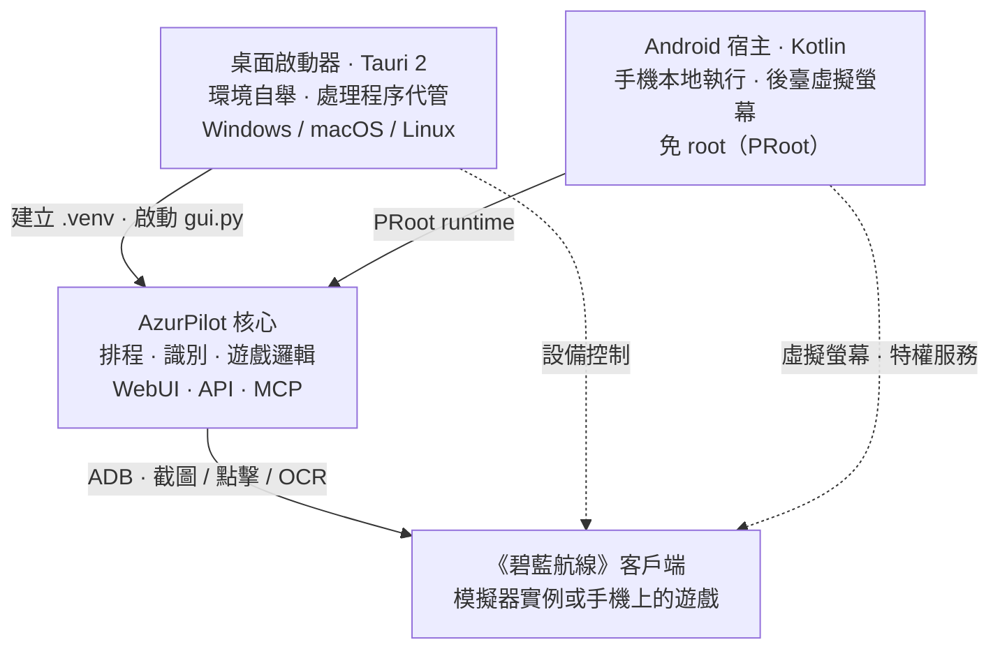

# 三個專案的關係

三個倉庫經常被誤認為「三個版本」，實際是**一個引擎 + 兩個宿主**。選錯倉庫會導致你把啟動器當成腳本本體，或者以為 Android 版有獨立的功能實現。



<small>實線：啟動與程式碼分發；虛線：設備控制鏈路。核心程式不關心自己被誰拉起。</small>

## <DocIcon name="scale" /> 職責對照

<table>
<thead>
<tr><th>倉庫</th><th>預設分支</th><th>語言 / 框架</th><th>許可證</th><th>負責</th><th>不負責</th></tr>
</thead>
<tbody>
<tr>
<td><a href="https://github.com/wess09/AzurPilot">wess09/AzurPilot</a></td>
<td><code>master</code></td>
<td>Python 3.14 · React · Vite</td>
<td>GPL-3.0</td>
<td>排程、識別、遊戲邏輯、WebUI、API、MCP</td>
<td>準備 Python 環境、代管處理程序、手機適配</td>
</tr>
<tr>
<td><a href="https://github.com/wess09/AzurPilotLauncher">wess09/AzurPilotLauncher</a></td>
<td><code>main</code></td>
<td>Rust · Tauri 2</td>
<td>GPL-3.0</td>
<td>桌面環境自舉、程式碼更新、後端處理程序代管、系統匣與通知</td>
<td>任何遊戲行為</td>
</tr>
<tr>
<td><a href="https://github.com/wess09/AzurPilot-for-Android">wess09/AzurPilot-for-Android</a></td>
<td><code>main</code></td>
<td>Kotlin · Compose · C++ · Python Runtime</td>
<td>AGPL-3.0</td>
<td>PRoot 執行時、虛擬螢幕、特權服務、OCR 加速、遠端客戶端</td>
<td>遊戲邏輯（複用上游核心）</td>
</tr>
</tbody>
</table>

::: tip 預設分支不是 master
核心倉庫用 `master`，另外兩個用 `main`。從舊文章複製連結時經常在這裡 404。
:::

## <DocIcon name="handshake" /> 依賴方向

```text
Launcher ──git pull──▶ AzurPilot（核心仓库）
   │                      ▲
   └──uv sync──▶ .venv     │
                           │ 同一份源码被打包进 rootfs
Android ──PRoot──▶ Ubuntu 24.04 ──▶ AzurPilot
```

- <DocIcon name="refresh" /> **啟動器不包含核心程式碼**。它在首次啟動時 `git clone` 核心倉庫，之後每次啟動 `git pull` 並 `uv sync`。所以「啟動器版本」和「核心版本」是兩條獨立的版本線。
- <DocIcon name="package" /> **Android 宿主內置核心程式碼**。Runtime 鏡像裡已經包含一份 AzurPilot 原始碼與前端構建產物，因此斷網也能啟動；上游更新通過單獨的腳本熱更新通道完成。
- <DocIcon name="plug" /> **三者共享同一套 WebSocket 協議**。Android 的 `AzurPilotGateway` 與瀏覽器 WebUI 訂閱的是同一個 `/api/v1/ws`。

## <DocIcon name="package" /> 我應該下載哪個

| 你的情況 | 選擇 | 入口 |
| --- | --- | --- |
| 有 Windows / macOS / Linux 電腦，用模擬器 | Launcher | [安裝啟動器](/zh-TW/launcher/user/install) |
| 沒有電腦，或想讓舊手機專職掛機 | Android APK | [安裝 Android 版](/zh-TW/android/user/install) |
| 已經在用其他機器上的實例，只想用手機看 | Android APK 的遠端客戶端模式 | [遠端客戶端](/zh-TW/android/user/remote-client) |
| 要改程式碼、寫新任務、調 API | 原始碼 | [原始碼執行](/zh-TW/guide/install#原始碼執行) |
| 伺服器 / NAS / 樹莓派 | Docker 或原始碼 | [Docker 部署](#docker-部署) |

## <DocIcon name="refresh" /> 版本與更新節奏

三個倉庫獨立發佈，版本號不互相對應：

- <DocIcon name="refresh" /> **核心**：跟隨 `master` 滾動更新，沒有嚴格的語義化版本；WebUI 的「更新」頁可以查看提交列表並按需應用。
- <DocIcon name="medal" /> **啟動器**：帶版本號的 Release（壓縮包），通過 mTLS 通道自更新，支援多鏡像回退。
- <DocIcon name="package" /> **Android**：雙軌發佈——輕量 APK（宿主程式碼）+ Runtime（rootfs 鏡像）。兩者都按 ABI 分發。

升級其中一個組件後會發生什麼，見[更新、備份與遷移](/zh-TW/guide/update-backup)。

## <DocIcon name="box" /> Docker 部署

核心倉庫自帶 Dockerfile 與 `docker-compose.yml`，適合無桌面環境：

```bash
git clone https://github.com/wess09/AzurPilot.git
cd AzurPilot
docker compose up -d --build
```

鏡像分「構建前端 → Python 執行時」兩個階段，容器內以 `.venv/bin/python gui.py` 啟動。倉庫另有 `deploy/docker/Dockerfile.cn` 供國內網路使用。

::: warning 容器內沒有模擬器
容器只提供 WebUI 與排程器。模擬器仍在宿主機上執行，需要把 ADB 連接埠映射進容器，或用 `network_mode: host`。具體做法取決於你的模擬器與網路拓撲。
:::

## <DocIcon name="file" /> 許可證

許可證具有傳染性：分發修改版時必須同時遵守 GPL-3.0 / AGPL-3.0。Android 宿主因為通過網路提供服務，AGPL 要求向網路用戶提供對應原始碼。
