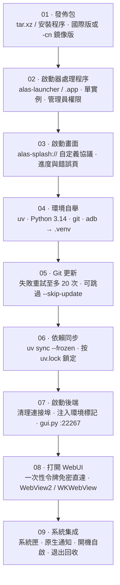

# 首次啟動與環境初始化

啟動器第一次執行時做的不是「打開一個網頁」，而是在你的目錄裡搭一套完整的 Python 執行環境。理解這條鏈路，出問題時就知道該刪哪個目錄。



<small>首次啟動會執行全部步驟，之後只跑 05–09。常駐處理程序鏈：啟動器（父）→ `gui.py`（子）→ 實例 worker（孫），退出時按 Job Object / 處理程序組回收。</small>

## <DocIcon name="sparkles" /> 啟動畫面

啟動器用自定義 URI 協議加載內嵌頁面：

| 協議 | 內容 |
| --- | --- |
| `alas-splash://` | 啟動畫面與進度 |
| `alas-error://` | 錯誤頁（可複製日誌） |

進度按階段推進：建立 `.venv` → 下載 Python → 更新倉庫 → 同步依賴 → 啟動後端 → 打開 WebUI。每一步都有對應的日誌行。

## <DocIcon name="box" /> 環境自舉做了什麼

| 組件 | 來源 | 位置 |
| --- | --- | --- |
| uv | 構建時內嵌（`ALAS_BOOTSTRAP_UV`） | `.venv` 或 PATH 回退 |
| Python 3.14.6 | python-build-standalone | `.venv` |
| git | Windows MinGit / Unix 原始碼編譯 | `.venv/bin/git`、`.venv/Scripts/git/cmd/git.exe` |
| adb | Android platform-tools | `.venv/bin/adb`、`.venv/Scripts/adb.exe` |

Python 下載源按順序嘗試：

```text
npmmirror（默认首选）
mirror.nju.edu.cn
python-standalone.org
github.com/astral-sh/python-build-standalone
```

PyPI 鏡像同理（阿里雲、騰訊雲、CERNET）。`-cn` 部署配置會優先國內源。

::: tip 為什麼 .venv 是可重定位的
Python 通過相對路徑找 `pyvenv.cfg` 與 `site-packages`，整個目錄可以隨專案移動。這也是啟動器能把工具鏈全部塞進 `.venv` 的前提。
:::

## <DocIcon name="refresh" /> 更新核心倉庫

```text
git pull → 失败重试（至多 20 次，指数退避）→ 成功
```

`deploy.<platform>.yaml` 決定倉庫地址、分支、代理與 SSL 校驗：

| 字段 | 說明 |
| --- | --- |
| `Git.Repository` | 倉庫地址；CN 版用 `git://git.pull/AzurPilot` |
| `Git.Branch` | 預設 `master`；開發者可改 `dev` |
| `Git.GitProxy` | HTTP / SOCKS5 代理 |
| `Git.SSLVerify` | 是否校驗證書 |

::: warning 不要手動改 git 倉庫的 remote 後繼續用啟動器
啟動器按部署配置裡的地址更新。手動換成 fork 後，下次啟動可能被拉回原倉庫，或產生衝突。要換源就改 `deploy.yaml`。
:::

## <DocIcon name="package" /> 依賴同步

```bash
uv sync --frozen
```

- `--frozen` 表示完全按 `uv.lock` 安裝，不重新解析。
- 依賴安裝失敗會停在錯誤頁，不會帶病啟動。
- 首次同步耗時最長，後續命中快取會快很多。

## <DocIcon name="rocket" /> 啟動後端

啟動器以子處理程序方式執行 `gui.py`，並注入環境標記：

| 變數 | 作用 |
| --- | --- |
| `ALAS_LAUNCHER_PID` | 標記子處理程序歸屬，退出時兜底清理 |
| `ALAS_LAUNCHER_JOB_BREAKAWAY` | 能力聲明，允許模擬器脫離 Job |
| `ALAS_WEBUI_TRUST_SECRET` | 一次性免密登入令牌 |

細節：

- 啟動前清理連接埠佔用（預設 `22267`）。**這會結束佔用該連接埠的處理程序**，如果你同時跑了別的 AzurPilot 實例，注意衝突。
- 等待後端就緒最多 60 秒；超時進入錯誤頁。
- WebUI 通過 WebView 承載，SSE 通知流斷開後每 3 秒重連。
- 視窗打開時已完成登入，不需要輸入密碼。這不代表 WebUI 沒有密碼，只是啟動器預置了會話。

## <DocIcon name="settings" /> 單實例與系統匣

- 重複啟動會聚焦已有視窗，不會再起一個後端。
- 關閉視窗預設最小化到系統匣，後端繼續執行。
- 系統匣菜單可以退出（真正結束後端）、重新啟動、打開日誌目錄。

## <DocIcon name="circle-alert" /> 初始化失敗

錯誤頁會顯示階段與原因。按階段疑難排解：

| 階段 | 常見原因 | 處理 |
| --- | --- | --- |
| 建立 `.venv` | 目錄只讀 / 路徑含特殊字符 | 換目錄 |
| 下載 Python | 網路不通、鏡像不可用 | 換網路或改部署配置源 |
| 更新倉庫 | 代理錯誤、分支不存在、硬碟滿 | 檢查 `deploy.yaml`、`--skip-update` 試啟動 |
| 同步依賴 | PyPI 不可達、`uv.lock` 與程式碼不匹配 | 換鏡像；確認程式碼與鎖檔案同版本 |
| 啟動後端 | 連接埠被佔用、Python 崩潰 | 看 `log/*_launcher.txt` 與後端日誌 |
| 打開 WebUI | WebView2 缺失 | 安裝執行時 |

### 查看日誌

```text
log/<日期>_launcher.txt    # 启动器（tracing）
log/<日期>_<实例>.txt       # 核心程序
```

啟動器日誌包含每個階段的命令、退出碼與耗時。提 Issue 時附這一段。

## <DocIcon name="ban" /> 跳過更新

```bash
./alas-launcher --skip-update
```

適用場景：

- 網路無法訪問 GitHub，但本地程式碼可用。
- 更新後啟動失敗，想回到當前版本疑難排解。
- 離線環境（需已有完整 `.venv`）。

## <DocIcon name="message-text" /> 語言

```bash
./alas-launcher --lang ja
```

可選 `zh-CN` / `zh-TW` / `ja` / `en`。不指定時按系統 locale 自動選擇，回退 `en`。這個參數隻影響啟動器介面，WebUI 語言由部署配置決定。
